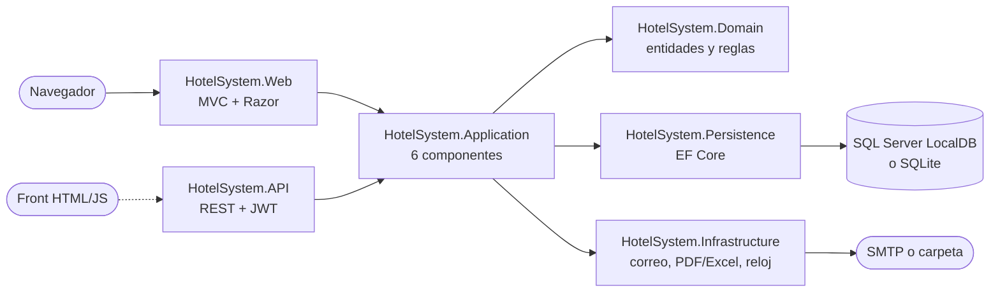
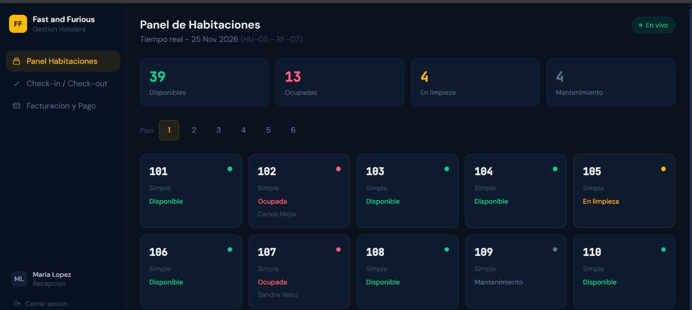

# Sistema de Gestión Hotelera — Hotel Fast and Furious

Sistema web para el Hotel Fast and Furious, un hotel vacacional de 60 habitaciones que gestionaba
sus reservas, tours, servicios adicionales y limpieza de forma manual (planillas de Excel, WhatsApp
y vales de papel). La solución centraliza la reserva de habitaciones y tours, el estado de las
habitaciones en tiempo real, los consumos de servicios adicionales, la cuenta única del huésped,
la gestión de usuarios por rol y los reportes de gestión, con las reglas de negocio aplicadas en
el backend.

Proyecto del curso **Diseño de Sistemas de Información** del Instituto Tecnológico Metropolitano
(ITM), 2026. Docente: Alexandra Guerrero Bocanegra. Esta versión corresponde al **Entregable 3**:
MVP funcional con flujos alternativos.

## Contenido

1. [Integrantes](#1-integrantes)
2. [Tecnologías utilizadas](#2-tecnologías-utilizadas)
3. [Arquitectura general](#3-arquitectura-general)
4. [Funcionalidades implementadas](#4-funcionalidades-implementadas)
5. [Requisitos de instalación](#5-requisitos-de-instalación)
6. [Configuración del entorno y dependencias](#6-configuración-del-entorno-y-dependencias)
7. [Cómo ejecutar el frontend y el backend](#7-cómo-ejecutar-el-frontend-y-el-backend)
8. [Pruebas automatizadas](#8-pruebas-automatizadas)
9. [API REST](#9-api-rest)
10. [Despliegue](#10-despliegue)
11. [Documentación técnica y diagramas](#11-documentación-técnica-y-diagramas)
12. [Evidencias del MVP](#12-evidencias-del-mvp)
13. [Limitaciones conocidas](#13-limitaciones-conocidas)
14. [Uso de inteligencia artificial](#14-uso-de-inteligencia-artificial)

---

## 1. Integrantes

| Integrante | Usuario de GitHub | Historial |
|---|---|---|
| Andres Santiago Henao Carvajal | [santyhenao07](https://github.com/santyhenao07) | [Commits](https://github.com/Samuel-Sanchez24/Sistema-Hotel/commits/main/?author=santyhenao07) |
| David Arboleda Londoño | [davidmia24](https://github.com/davidmia24) | [Commits](https://github.com/Samuel-Sanchez24/Sistema-Hotel/commits/main/?author=davidmia24) |
| Samuel Andrés Sánchez Orrego | [Samuel-Sanchez24](https://github.com/Samuel-Sanchez24) | [Commits](https://github.com/Samuel-Sanchez24/Sistema-Hotel/commits/main/?author=Samuel-Sanchez24) |
| Alejandro Jaramillo Agudelo | [AlejoJaramillo0206](https://github.com/AlejoJaramillo0206) | [Commits](https://github.com/Samuel-Sanchez24/Sistema-Hotel/commits/main/?author=AlejoJaramillo0206) |
| Jose David Quintero Estupiñan | [Jose17819](https://github.com/Jose17819) | [Commits](https://github.com/Samuel-Sanchez24/Sistema-Hotel/commits/main/?author=Jose17819) |

Para ver cuántos commits tiene cada integrante: `git shortlog -sn` en la carpeta del repositorio.

## 2. Tecnologías utilizadas

| Parte | Tecnología |
|---|---|
| Lenguaje y plataforma | C# sobre .NET 10 |
| Frontend web | ASP.NET Core MVC con vistas Razor, Tailwind CSS 4 (compilado en `wwwroot/css/hotel.css`) y JavaScript para refrescar los paneles cada 3 segundos |
| API | ASP.NET Core Web API, autenticación con JWT y documento OpenAPI |
| Datos | Entity Framework Core 10 con SQL Server LocalDB; SQLite como respaldo y en las pruebas |
| Seguridad | Contraseñas con hash PBKDF2-SHA256 (100.000 iteraciones); acceso por rol en la web (`RoleAuthorize`) y en la API (JWT) |
| Reportes | PDF y Excel (.xlsx) generados sin librerías externas |
| Correo | SMTP, o archivos HTML en una carpeta para la demostración |
| Pruebas | xUnit |
| Diseño y gestión | Jira (historias de usuario), Figma (prototipo), PlantUML (C4, actividades y máquinas de estados), draw.io (componentes y despliegue), Lucidchart (secuencia), Git y GitHub |

## 3. Arquitectura general

### 3.1 Capas y componentes

```
HotelSystem.Domain          Entidades, enums, patrón State, interfaces ICalculable / IPagable / IObservadorHabitacion
HotelSystem.Application     Servicios por módulo (C4 nivel 3), reglas de negocio, Facade, Factory Method, Strategy (contexto), Observer (paneles)
HotelSystem.Persistence     Entity Framework Core: HotelDbContext, repositorios, unidad de trabajo, datos de demostración
HotelSystem.Infrastructure  Reloj, contraseñas (PBKDF2), correo, exportadores PDF y Excel (estrategias)
HotelSystem.Web             Frontend: ASP.NET Core MVC con vistas Razor
HotelSystem.API             API REST con JWT para clientes externos (por ejemplo, el front HTML/JS)
HotelSystem.Tests           Pruebas automatizadas (xUnit)
```



Las flechas muestran quién llama a quién durante la ejecución. En el código, las dependencias van
hacia adentro: `Domain ← Application ← Persistence / Infrastructure ← Web / API`. El dominio no conoce
la base de datos: los servicios dependen de interfaces (`IReservaHabitacionRepository`,
`IServicioCorreo`, `IReloj`...) que Persistence e Infrastructure implementan, y la inyección de
dependencias las conecta.

La web MVC usa los servicios de `Application` en el mismo proceso. La API expone esos mismos
servicios por REST. Así las reglas de negocio están en un solo lugar y las dos entradas las comparten.

Los seis componentes del **C4 nivel 3** son las carpetas de `HotelSystem.Application`: `Usuarios`
(Usuarios y Accesos), `Reservas`, `ServiciosAdicionales`, `Tours`, `Housekeeping` y `CierreCuenta`.

### 3.2 Tipo de arquitectura

Arquitectura **en capas** de tipo cliente-servidor web: presentación (`Web` y `API`), aplicación, dominio e
infraestructura (`Persistence` e `Infrastructure`). Las dependencias apuntan hacia el dominio, como en la
arquitectura limpia (Clean Architecture), y la capa de aplicación define las interfaces que la infraestructura
implementa. La presentación web usa MVC. Se despliega como un backend monolítico y modular con dos entradas
(web MVC y API REST) que comparten las mismas reglas de negocio.

### 3.3 Patrones GoF

| Patrón | Dónde está | Qué resuelve |
|---|---|---|
| **State** | `Domain/Estados/` (`IEstadoHabitacion`, `EstadoHabitacionBase`, `EstadoDisponible`, `EstadoOcupada`, `EstadoEnLimpieza`, `EstadoMantenimiento`) y `Habitacion` | Cada estado decide qué transiciones permite (RN-02). Una transición inválida lanza la excepción con el mensaje de la regla (HU-05, HU-06, HU-11) |
| **Observer** | Sujeto: `Habitacion` (`Suscribir`, notifica en cada cambio). Observadores: `PanelRecepcion`, `PanelHousekeeping` (`Application/Reservas/`) | Recepción y housekeeping se enteran de los cambios de estado. Las pantallas consultan `/Eventos/Version` cada 3 s y se recargan solas (HU-05, HU-11) |
| **Facade** | `CierreCuenta/CuentaFacade.cs` | Una sola llamada (`CerrarCuenta`) consolida la cuenta, valida el pago, cierra la cuenta, finaliza la reserva, deja la habitación en limpieza y genera la prefactura, en una transacción (HU-06, HU-12) |
| **Factory Method** | `Usuarios/CreadorUsuario.cs` (creador abstracto), `CreadorHuesped`, `CreadorEmpleado` | El flujo de alta es común; cada subclase decide qué `Persona` crea y sus validaciones (RN-10 para huésped, RN-08 para empleado) (HU-01) |
| **Strategy** | Interfaz `CierreCuenta/IExportadorReporte.cs`; estrategias `Infrastructure/Reportes/ExportadorPDF.cs` y `ExportadorExcel.cs`; contexto `GeneradorReportes` | El formato del reporte se elige en tiempo de ejecución. Un formato nuevo es una clase nueva y una línea en la inyección de dependencias (HU-13) |

### 3.4 Principios SOLID: del prototipo del Entregable 2 al MVP

| Principio | Antes (prototipo del E2) | Ahora (MVP) |
|---|---|---|
| SRP | Reglas de negocio dentro de los controladores; `InMemoryHotelDataService` atendía ocho áreas | Los controladores solo leen el formulario, llaman al servicio y eligen la vista. Las reglas están en el dominio y en `Application`, con un servicio por módulo |
| OCP | Filtros y formatos decididos con `switch`; cancelación con un valor fijo | Estados como clases (State), formatos como estrategias (Strategy) y `IPoliticaCancelacion` (`PoliticaCancelacion48Horas`), configurable en `appsettings.json` |
| LSP | `IPagable` obligaba a `ReservaTour` a implementar un pago que no le corresponde | `ICalculable` (Cuenta, ReservaTour) e `IPagable` (solo Cuenta). Todas las estrategias de exportación cumplen el mismo contrato |
| ISP | `IHotelDataService` con 32 métodos para todos los controladores | Un servicio por módulo: `IAuthService`, `IUsuarioService`, `IReservaService`, `IHabitacionService`, `ITourService`, `IServicioAdicionalService`, `ICuentaService`, `IReporteService`. Cada controlador recibe solo los que usa |
| DIP | Uso directo de la clase estática `MockData` y de `DateTime.Now` | Repositorios, `IServicioCorreo` e `IReloj` inyectados; base de datos real con Entity Framework Core |

## 4. Funcionalidades implementadas

### 4.1 Por historia de usuario

| HU | Funcionalidad | Rol | Web (controlador) | API |
|---|---|---|---|---|
| HU-01 | Crear, cambiar de rol, desactivar y reactivar cuentas de personal | Administrador | `AdminController` | `/api/usuarios` |
| HU-02 | Iniciar sesión y ver solo las funciones del rol | Todos | `AccountController` | `/api/auth/login` |
| HU-03 | Reservar una habitación (asistente de 3 pasos) y cancelarla | Huésped | `HuespedController` | `/api/habitaciones/disponibles`, `/api/reservas` |
| HU-04 | Recibir la confirmación de la reserva por correo | Huésped | `ReservaService` + `IServicioCorreo` | (al reservar) |
| HU-05 | Ver el estado de las 60 habitaciones en tiempo real | Recepción | `RecepcionController.Index` | `/api/habitaciones` |
| HU-06 | Registrar el check-in y el check-out, con pago y cierre de cuenta | Recepción | `RecepcionController` | `/api/recepcion`, `/api/cuentas/{hab}/cerrar` |
| HU-07 | Solicitar servicios adicionales y consultar los consumos | Huésped | `HuespedController` | `/api/servicios`, `/api/solicitudes-servicio` |
| HU-08 | Registrar un consumo en el punto de servicio | Servicios | `ServiciosController` | `/api/consumos` |
| HU-09 | Reservar un tour y cargarlo a la cuenta de la estancia | Huésped | `HuespedController` | `/api/tours/{id}/reservas` |
| HU-10 | Administrar cupos y asignar guías y vehículos | Coordinador de tours | `ToursController` | `/api/tours/...` |
| HU-11 | Cambiar el estado de las habitaciones, reportar incidencias y ver el plan de limpieza | Housekeeping | `HousekeepingController` | `/api/habitaciones/{id}/estado`, `/api/housekeeping/plan-limpieza` |
| HU-12 | Generar y consultar la prefactura consolidada | Recepción y huésped | `RecepcionController.Facturacion`, `HuespedController.MiCuenta` | `/api/cuentas/...` |
| HU-13 | Generar reportes de gestión y exportarlos en PDF o Excel | Administrador | `AdminController.Reportes` | `/api/reportes`, `/api/reportes/exportar` |

### 4.2 Flujos alternativos y validaciones

Todos estos casos están implementados en el código y se pueden provocar en la web con los usuarios
de prueba de la sección 7.3.

| HU | Flujo alternativo | Qué hace el sistema | Regla o escenario |
|---|---|---|---|
| HU-01 | Crear un empleado sin rol o con un correo ya registrado | Rechaza el registro | RN-08 y correo único |
| HU-02 | Contraseña incorrecta | Mensaje genérico de credenciales incorrectas | HU-02 Esc.2 |
| HU-02 | Cuenta desactivada (`jherrera`) | Rechaza el acceso y avisa que la cuenta está desactivada | HU-02 Esc.3 |
| HU-02 | Entrar por el perfil de otro rol o abrir por URL una pantalla de otro rol | Rechaza el acceso | RN-08, HU-02 Esc.4 |
| HU-03 | Más huéspedes que la capacidad, o fechas ya ocupadas | No ofrece habitaciones; si las fechas se cruzan al guardar, rechaza la reserva | RN-01, RN-11, HU-03 Esc.2 |
| HU-03 | Confirmar sin medio de pago | No confirma la reserva | RN-04, HU-03 Esc.3 |
| HU-03 | Titular menor de edad (`tomas.lagos`) | Rechaza aunque marque la casilla, porque revisa la fecha de nacimiento | RN-10, HU-03 Esc.4 |
| HU-03 | Cancelar con 48 horas o más, o con menos de 48 horas | Sin cargo, o con cargo de una noche | RN-09, HU-03 Esc.5 y Esc.6 |
| HU-03 | Dos huéspedes reservan la misma habitación al mismo tiempo | Solo una reserva se guarda; la otra recibe un mensaje | RNF-07 |
| HU-04 | Falla el envío del correo | La reserva queda confirmada igual | HU-04 Esc.2 |
| HU-06 | Check-in de una habitación que sigue en limpieza | Rechaza el check-in | RN-02 |
| HU-06 | Monto pagado distinto de la prefactura | No cierra la cuenta y no cambia nada | HU-06 Esc.5 |
| HU-07 | Huésped sin check-in activo | Pide un check-in activo para solicitar servicios | HU-07 Esc.2 |
| HU-08 | Consumo con fecha de otro día | Rechaza el consumo | RN-06 |
| HU-08 | Habitación sin estancia o con la cuenta cerrada | Rechaza el consumo | RN-07 |
| HU-09 | Tour sin cupos suficientes | Rechaza la reserva y pide otra fecha o tour | RN-11, HU-09 Esc.2 |
| HU-09 | Sin medio de pago, titular menor de edad o sin estancia vigente en la fecha del tour | Rechaza la reserva | RN-04, RN-10, RN-07 |
| HU-10 | Guía o vehículo ya asignado a otro tour en el mismo horario | Rechaza la asignación | RN-03, HU-10 Esc.4 |
| HU-10 | Liberar cupos que pertenecen a huéspedes | Solo deja liberar los cupos bloqueados a mano | RN-05 |
| HU-11 | Reportar una incidencia sin descripción | Pide la descripción | HU-11 Esc.3 |
| HU-11 | Marcar una habitación como Ocupada desde housekeeping | Rechaza el cambio: solo el check-in la ocupa | RN-02 |
| HU-13 | Rango de fechas sin registros | Avisa que no hay registros en el periodo | HU-13 Esc.2 |
| HU-13 | Usuario sin rol de administrador | Deniega el acceso | RN-08, HU-13 Esc.3 |

**Cómo se manejan los errores.** Cada regla incumplida lanza `ReglaNegocioException` con su código
(por ejemplo, RN-04). La web muestra el mensaje como aviso en la misma pantalla, y la API responde con
un código 4xx y `{ "mensaje": "...", "regla": "RN-04" }`. Los datos del formulario (campos
obligatorios, formato del correo, contraseña de al menos 6 caracteres) se validan antes de abrir la
transacción. Lo que depende de la base (disponibilidad, cupos, cuenta abierta) se valida dentro de una
transacción serializable, junto con el guardado.

### 4.3 Reglas de negocio

| Regla | Dónde se aplica |
|---|---|
| RN-01 Sin doble reserva | `ReservaService.ReservarHabitacion` (transacción serializable) y `BuscarDisponibles` |
| RN-02 Estados de habitación | Patrón State; check-in solo con habitación Disponible; Ocupada solo por check-in |
| RN-03 Guía/vehículo sin cruce de horario | `TourService.AsignarRecursos` y `ListarRecursos` |
| RN-04 Respaldo de pago | `ReservarHabitacion`, `ReservarTour` |
| RN-05 Cupos de tour bloqueados | `ReservarTour` bloquea en la misma transacción; `LiberarCupos` no libera cupos de huéspedes |
| RN-06 Consumos del mismo día | `ServicioAdicionalService.RegistrarConsumo` |
| RN-07 Cuenta única | `Cuenta` (alojamiento + servicios + tours); consumos y tours solo con cuenta abierta |
| RN-08 Un rol por empleado | `Empleado.Rol` único; `CambiarRol` reemplaza el anterior |
| RN-09 Cancelación < 48 h cobra 1 noche | `PoliticaCancelacion48Horas` |
| RN-10 Titular mayor de edad | Fecha de nacimiento (`Persona.EsMayorDeEdad`) además de la casilla del formulario |
| RN-11 Capacidad | `ReservaHabitacion` (capacidad de la habitación) y `Tour` (cupo máximo) |
| RNF-07 Concurrencia | `UnidadDeTrabajo`: transacciones serializables; un choque se informa como mensaje, no como error |

## 5. Requisitos de instalación

- **Opción 1:** Windows 10 u 11 con Visual Studio 2026 y la carga de trabajo *Desarrollo de ASP.NET y
  web*, que incluye el SDK de .NET 10 y SQL Server LocalDB.
- **Opción 2:** cualquier sistema operativo con el [SDK de .NET 10](https://dotnet.microsoft.com/download)
  y un editor como VS Code. Sin SQL Server, el sistema usa SQLite de forma automática.
- Git, para clonar el repositorio.
- Conexión a internet la primera vez, para descargar los paquetes NuGet.
- Navegador actualizado: Chrome, Edge o Safari (RNF-05).

## 6. Configuración del entorno y dependencias

```bash
git clone https://github.com/Samuel-Sanchez24/Sistema-Hotel.git
cd Sistema-Hotel
dotnet restore HotelSystem.slnx
```

### 6.1 Dependencias (NuGet)

Se descargan solas al compilar o con `dotnet restore`.

| Proyecto | Paquetes |
|---|---|
| `HotelSystem.Domain` | Ninguno |
| `HotelSystem.Application` | Microsoft.Extensions.DependencyInjection.Abstractions 10.0 |
| `HotelSystem.Infrastructure` | Microsoft.Extensions.DependencyInjection.Abstractions 10.0, Microsoft.Extensions.Logging.Abstractions 10.0 |
| `HotelSystem.Persistence` | Microsoft.EntityFrameworkCore.SqlServer 10.0, Microsoft.EntityFrameworkCore.Sqlite 10.0 |
| `HotelSystem.Web` | Ninguno adicional (usa Application, Persistence e Infrastructure) |
| `HotelSystem.API` | Microsoft.AspNetCore.Authentication.JwtBearer 10.0, Microsoft.AspNetCore.OpenApi 10.0.11 |
| `HotelSystem.Tests` | xunit 2.9.2, xunit.runner.visualstudio 2.8.2, Microsoft.NET.Test.Sdk 17.12.0, Microsoft.Extensions.DependencyInjection 10.0 |

### 6.2 Configuración (`appsettings.json`)

`HotelSystem.Web` y `HotelSystem.API` tienen cada uno su `appsettings.json` con las mismas secciones;
la API agrega `Jwt` y `Cors`.

| Clave | Valor por defecto | Para qué sirve |
|---|---|---|
| `BaseDeDatos:Proveedor` | `Auto` | `Auto` usa SQL Server y, si no responde, SQLite. También acepta `SqlServer` o `Sqlite` |
| `BaseDeDatos:SqlServer` | `(localdb)\MSSQLLocalDB`, base `HotelFastAndFurious` | Cadena de conexión de SQL Server |
| `BaseDeDatos:Sqlite` | Vacío: `%LOCALAPPDATA%\HotelFastAndFurious\hotel.db` | Ruta del archivo SQLite |
| `BaseDeDatos:ReiniciarAlIniciar` | `false` | Vuelve a cargar los datos de demostración al arrancar |
| `Correo:Modo` | `Carpeta` | `Carpeta` (guarda cada correo como HTML en `App_Data/correos`), `Smtp` (envío real) o `Desactivado` |
| `Hotel:FechaActual` | Vacío (hoy) | Fija la fecha del sistema para repetir una demostración |
| `Hotel:HoraCheckIn` | `15:00` | Hora del check-in, para calcular la cancelación (RN-09) |
| `Hotel:HorasCancelacionSinCargo` | `48` | Horas antes del check-in hasta las que cancelar no tiene cargo (RN-09) |
| `Hotel:HorasCancelacionTour` | `24` | Anticipación para cancelar un tour (HU-09) |
| `Jwt:Clave` (API) | Clave de desarrollo | Firma de los tokens. Cámbiela fuera de desarrollo |
| `Cors:Origenes` (API) | `http://127.0.0.1:5500`, `http://localhost:5500` | Orígenes del front HTML/JS (Live Server) |

No suba claves reales al repositorio. Defina `Correo:Clave` y `Jwt:Clave` como variables de entorno
(`Correo__Clave`, `Jwt__Clave`).

**Base de datos.** Las tablas se crean solas (`EnsureCreated`); no hay migraciones, así que si cambia
el modelo hay que reiniciar los datos. La web y la API comparten la misma base de datos.

## 7. Cómo ejecutar el frontend y el backend

El **frontend** del MVP es `HotelSystem.Web`. Usa los servicios del backend en el mismo proceso, así
que basta con ejecutarlo para probar todo el sistema. El **backend** se expone además como
`HotelSystem.API`, para clientes externos.

### 7.1 Con Visual Studio

1. Abra `HotelSystem.slnx`.
2. Clic derecho en **HotelSystem.Web** → *Establecer como proyecto de inicio*.
3. Presione **F5**. La primera vez se crea la base de datos y se cargan los datos de demostración.
4. En el login elija un perfil: el usuario ya viene escrito y la contraseña aparece debajo.

Para ejecutar la web y la API al tiempo: clic derecho en la solución → *Configurar proyectos de
inicio* → *Varios proyectos de inicio* → marcar *Iniciar* en HotelSystem.Web y HotelSystem.API.

### 7.2 Con la línea de comandos

```bash
# Frontend web (incluye las capas del backend): https://localhost:7299
dotnet run --project HotelSystem.Web --launch-profile https

# API REST, en otra terminal: https://localhost:7001
dotnet run --project HotelSystem.API --launch-profile https
```

Si el navegador avisa por el certificado de desarrollo, ejecute una vez `dotnet dev-certs https --trust`.

### 7.3 Usuarios de prueba

| Perfil | Usuario | Contraseña |
|---|---|---|
| Huésped (estancia en curso, hab. 408) | `valentina.lagos` | `guest2026` |
| Recepción | `mlopez` | `recep2026` |
| Housekeeping | `amartinez` | `hk2026` |
| Coordinador de tours | `ltorres` | `coord2026` |
| Servicios | `pgomez` | `serv2026` |
| Administrador | `rsilva` | `admin2026` |
| Cuenta desactivada (HU-02 Esc.3) | `jherrera` | `hk2026` |
| Huésped menor de edad (RN-10) | `tomas.lagos` | `guest2026` |

### 7.4 Datos de demostración

Antes de una sustentación, use el enlace *Reiniciar datos de demostración* del login (solo en
desarrollo). También se puede iniciar con el argumento `--reiniciar-datos` o poner
`"ReiniciarAlIniciar": true` en `appsettings.json`.

Las fechas de los datos de demostración se calculan a partir del día en que se cargan, así que
siempre hay llegadas y salidas "hoy". Para repetir una demostración con fechas fijas, ponga una fecha
en `"Hotel": { "FechaActual": "2026-11-20" }`.

## 8. Pruebas automatizadas

Doble clic en **`verificar.cmd`** (en la carpeta de la solución): compila toda la solución con
`dotnet build`, ejecuta las pruebas con `dotnet test` y guarda el resultado en `verificacion.log`.
También se pueden ejecutar con:

```bash
dotnet test HotelSystem.Tests/HotelSystem.Tests.csproj
```

O desde Visual Studio: *Prueba → Explorador de pruebas → Ejecutar todas*.

Hay **59 pruebas** (61 casos, xUnit) en `HotelSystem.Tests`. Usan el sistema completo (mismas capas y
misma inyección de dependencias) sobre una base SQLite temporal y con un reloj fijo. Muchas
comprueban un flujo alternativo; las de reglas de negocio empiezan con el código de la regla (por
ejemplo, `RN04_SinMedioDePago_NoSeConfirma`).

| Archivo | Qué prueba |
|---|---|
| `DominioTests` | Patrón State (transiciones permitidas y rechazadas), Observer, `ICalculable`/`IPagable`, RN-11, cruce de fechas |
| `UsuariosTests` | Login (HU-02 Esc.1 a 3), Factory Method, contraseña temporal, cambio de rol (RN-08), reactivación (HU-01 Esc.5), RN-10 |
| `ReservasTests` | Reserva con noches reales, correo HU-04, RN-01, RN-04, RN-09, RN-10, RN-11, check-in, concurrencia (RNF-07) |
| `CuentaTests` | Facade: prefactura consolidada (RN-07), cierre de cuenta todo o nada, RN-06 |
| `ToursTests` | Cupos (RN-05, RN-11), guía y vehículo con horario cruzado (RN-03), tours cargados a la cuenta |
| `HabitacionesTests` | Housekeeping: RN-02 desde el servicio, incidencia con nota, paneles Observer, plan de limpieza |
| `ReportesTests` | Reporte con datos reales, periodo sin datos (HU-13 Esc.2), PDF y Excel válidos, Strategy y Liskov |

## 9. API REST

- URL: `https://localhost:7001/api`. Si usa el front HTML/JS, en su `js/config.js` ponga `USE_MOCK: false`.
- Autenticación: `POST /api/auth/login` con `{ "usuario", "contrasena" }` devuelve `{ token, expira, usuario }`.
  Las demás rutas piden `Authorization: Bearer <token>`.
- Errores: código 4xx con `{ "mensaje": "...", "regla": "RN-01" }` (400 regla incumplida, 401 sin
  sesión, 403 rol sin permiso, 404 no existe).
- Enums como texto en mayúsculas: `DISPONIBLE`, `EN_LIMPIEZA`, `COORDINADOR_TOURS`... Al enviar, la
  API también acepta `EnLimpieza` o `en limpieza`.
- Ejemplos listos para ejecutar en `HotelSystem.API/HotelSystem.API.http` (Visual Studio los envía con un clic).
- Documento OpenAPI: `https://localhost:7001/openapi/v1.json`.

## 10. Despliegue

El MVP se ejecuta en local; no tiene un despliegue público. El diagrama de despliegue
([imagen](https://drive.google.com/file/d/1L5bpPicHSzEM9eUDaBPZX6vdBuLUdVyp/view) y
[fuente editable](docs/diagramas/despliegue.drawio)) muestra cómo se distribuyen los artefactos en la
infraestructura propuesta para el hotel: `HotelSystem.Web` y `HotelSystem.API` en sus servidores, las dos
conectadas a la misma base de datos SQL Server.

## 11. Documentación técnica y diagramas

| Artefacto | Enlace |
|---|---|
| Documento del Entregable 3 | [Google Drive](https://drive.google.com/file/d/1zd2y1OCmWihhvo13mk5brt9gKia6cRmw/view) |
| Documento del Entregable 2 | [Google Docs](https://docs.google.com/document/d/1lIFpGCOWg7gPWZDTwJgERDuwa4dHm65U-v1EJ7DsSzo/edit) |
| Historias de usuario (proyecto HFF) | [Jira](https://quintero127.atlassian.net/jira/software/projects/HFF/boards/2/backlog) |
| Story Map | [Google Slides](https://docs.google.com/presentation/d/1rkfvhxB7-3KXSaDZFNRrTovoZ69rD9Z4/edit) |
| Prototipo de alta fidelidad | [Figma](https://www.figma.com/make/tm2Bd4fuzqLBdEPj1MRQql/Modelo-de-alta-fidelidad) |
| Arquitectura C4 del E2, niveles 1 a 4 (código PlantUML) | [Google Docs](https://docs.google.com/document/d/1mwgMrzx3fXkFCij9YVGFQA_9kT2u5TECGh1A4_D69wY/edit) |
| **C4 actualizado en el E3**: niveles 2 y 3, y nivel 4 con un diagrama de clases por componente (PlantUML e imágenes) | [docs/diagramas/c4](docs/diagramas/c4/) |
| Diagramas de actividades (código PlantUML) | [Google Docs](https://docs.google.com/document/d/1M8i7O0rPfl7FbJvxMYM7ehhyvY_yEY23Wl_JAg4qSyQ/edit) |
| Diagramas de máquina de estados | [Google Docs](https://docs.google.com/document/d/1Lryi31DVl2reo9ODAlTUJqgTCMBSWynU/edit); habitación: [PlantUML](docs/diagramas/maquina-estados-habitacion.puml) e [imagen](docs/diagramas/maquina-estados-habitacion.png) |
| Diagrama de componentes | [draw.io](docs/diagramas/componentes.drawio) |
| Diagrama de despliegue | [draw.io](docs/diagramas/despliegue.drawio) e [imagen en Google Drive](https://drive.google.com/file/d/1L5bpPicHSzEM9eUDaBPZX6vdBuLUdVyp/view) |
| Diagramas de secuencia | [Lucidchart](https://lucid.app/lucidchart/2f6c462b-fac8-4832-bd2e-ed2203e8798c/edit) (8 escenarios) y [docs/diagramas/secuencia](docs/diagramas/secuencia/) (HU-05, HU-07 y HU-09, en PlantUML) |
| Plantilla de análisis y selección de patrones GoF | [Google Drive](https://drive.google.com/file/d/1HXOqXD3JjyM74nqcf_RXlP-XE-poq9rC/view) |
| Plantilla de análisis de principios SOLID | [Google Drive](https://drive.google.com/file/d/1bBzU5oWOBgCcr3ADfMN0Fjd1BaRfZG24/view) |

Los archivos `.drawio` se abren en [diagrams.net](https://app.diagrams.net) (*Archivo → Abrir desde →
Dispositivo*). El código PlantUML se puede pegar en cualquier editor de PlantUML.

## 12. Evidencias del MVP

Las capturas están en la carpeta [`docs/evidencias/`](docs/evidencias/) y muestran el MVP en ejecución con
los datos de demostración.



| HU | Proceso | Captura |
|---|---|---|
| HU-01 | Gestión de usuarios del personal (RN-08) | [hu01-gestion-usuarios.jpg](docs/evidencias/hu01-gestion-usuarios.jpg) |
| HU-03 | Reserva de habitación, paso 2 de 3 (RNF-04) | [hu03-reservar-habitacion-paso2.jpg](docs/evidencias/hu03-reservar-habitacion-paso2.jpg) |
| HU-05 | Panel de habitaciones de recepción, en tiempo real | [hu05-panel-habitaciones.jpg](docs/evidencias/hu05-panel-habitaciones.jpg) |
| HU-06 | Check-in y check-out del día | [hu06-checkin-checkout.jpg](docs/evidencias/hu06-checkin-checkout.jpg) |
| HU-08 | Registro de un consumo (RN-06) | [hu08-registrar-consumo.jpg](docs/evidencias/hu08-registrar-consumo.jpg) |
| HU-08 | Historial de consumos | [hu08-historial-consumos.jpg](docs/evidencias/hu08-historial-consumos.jpg) |
| HU-10 | Panel de tours, con un tour lleno (RN-11) | [hu10-panel-tours.jpg](docs/evidencias/hu10-panel-tours.jpg) |
| HU-10 | Asignación de guía y vehículo (RN-03) | [hu10-asignacion-recursos.jpg](docs/evidencias/hu10-asignacion-recursos.jpg) |
| HU-11 | Estado de habitaciones en housekeeping (State) | [hu11-estado-habitaciones.jpg](docs/evidencias/hu11-estado-habitaciones.jpg) |
| HU-11 | Plan de limpieza diario (RF-10) | [hu11-plan-limpieza.jpg](docs/evidencias/hu11-plan-limpieza.jpg) |
| HU-12 | Prefactura consultada por el huésped (RN-07) | [hu12-prefactura-huesped.jpg](docs/evidencias/hu12-prefactura-huesped.jpg) |
| HU-13 | Reportes de gestión con exportación a PDF y Excel | [hu13-reportes.jpg](docs/evidencias/hu13-reportes.jpg) |

Los flujos alternativos de la sección 4.2 se pueden reproducir con los usuarios de prueba de la sección 7.3,
y la mayoría tiene su prueba automática (sección 8). Las capturas de los flujos alternativos y del resultado
de las pruebas están en el documento del Entregable 3, sección 4.4.

## 13. Limitaciones conocidas

- **RNF-02 (cifrado AES-256 de datos en reposo) no está implementado.** Las contraseñas sí se guardan
  con hash PBKDF2-SHA256 (100.000 iteraciones), nunca en texto plano.
- No hay pasarela de pagos en línea: el pago se registra en recepción (fuera del alcance del MVP).
- En la API, un cambio de rol o una desactivación aplica cuando el usuario vuelve a iniciar sesión
  (el token dura 8 horas).
- El MVP no tiene un despliegue público (sección 10).

## 14. Uso de inteligencia artificial

El equipo usó Claude (Anthropic) como asistente durante el Entregable 3:

- **Código del backend:** apoyo en la escritura y la revisión del código de las capas y de las pruebas
  automatizadas, y en la organización del trabajo en commits por módulo.
- **Documentación:** redacción y revisión de este README y del documento del entregable, a partir de los
  artefactos del equipo.
- **Diagramas:** revisión de la coherencia entre los diagramas y el código; actualización del código
  PlantUML del C4 (niveles 2 a 4), de la máquina de estados de la habitación y de los diagramas de secuencia de
  HU-05, HU-07 y HU-09, y generación de sus imágenes.
- **Plantillas GoF y SOLID:** revisión de las plantillas de análisis del Entregable 2.

Cada integrante revisó el módulo de sus commits, y el MVP se ejecutó y se probó con los usuarios de
demostración. El análisis, el diseño, la implementación y su sustentación son responsabilidad del equipo.
